<p align="center">
  <picture><source media="(max-width: 767px)" srcset="assets/readme/banner-m.png"></picture>
</p>

<p align="center">
  
  
  
</p>

Vector search over rows is good at "find something like this" and bad at "which suppliers ship to customers who returned an order". That second kind of question needs relationships. This prototype reads a relational database's schema, asks an LLM to turn it into an ontology, loads the rows into a graph database as nodes and edges, and serves one query endpoint that picks vector search, graph traversal or a plain filter for each question.

It is an early prototype: the pieces exist and are unit-tested with stubs, but there is no end-to-end demo dataset yet.

<p align="center">
  <picture><source media="(max-width: 767px)" srcset="assets/readme/glance-m.png"></picture>
</p>

## How it works

<p align="center">
  <picture><source media="(max-width: 767px)" srcset="assets/readme/how-it-works-m.png"></picture>
</p>

| Stage | Code | What it does |
|---|---|---|
| Read the schema | `src/schema_mapper/relational_schema_parser.py`, `src/utils/db_connector.py` | Tables, columns and keys through SQLAlchemy |
| Suggest an ontology | `src/schema_mapper/ontology_suggester.py` | Gemini proposes node and relationship types from the schema |
| Build the graph | `src/graph_constructor/graph_populator.py` | Writes nodes and edges to Neo4j (with `MERGE` to avoid duplicates) or AWS Neptune (Gremlin) |
| Embed | `src/vector_store/store.py` | A small in-memory cosine-similarity store |
| Answer | `src/retrieval_server/query_agent.py` | Routes "similar to…" questions to vector search, "connected to…" or "path" questions to graph traversal, the rest to filtering |
| Serve | `src/retrieval_server/main.py` | FastAPI, `GET /query/?q=...` |

If the Gemini SDK or credentials are missing, `llm_adapter.py` returns deterministic stub output, and the graph drivers fall back to stubs too. That keeps the tests runnable on any machine.

## Architecture

<p align="center">
  <picture><source media="(max-width: 767px)" srcset="assets/readme/architecture-m.png"></picture>
</p>

## Quick start

The code lives in [`Desktop/Random/graphrag-transformation/`](Desktop/Random/graphrag-transformation/).

```bash
cd Desktop/Random/graphrag-transformation
cp .env.example .env              # GOOGLE_API_KEY, Neo4j or Neptune settings
python -m unittest discover -s tests -p "test_*.py"
```

To store the graph locally, start Neo4j with the included compose file (user `neo4j`, password `secret`):

```bash
docker compose up -d
```

There is no `requirements.txt` yet. The modules import `fastapi`, `uvicorn`, `sqlalchemy`, `neo4j`, `gremlinpython` and `google-generativeai`; the unit tests use stubs instead.

## Status

- 9 unit tests; 8 pass. `test_decide_retrieval_strategy` fails because the router returns `vector_search` where the test expects `logical_filtering`.
- The project folder is nested under `Desktop/Random/` from the machine it was pushed from.

## License

No license file has been added yet, so default copyright applies.

<p align="center">
  <a href="https://github.com/JustKamlesH21"><picture><source media="(max-width: 767px)" srcset="assets/readme/footer-m.png"></picture></a>
</p>
